# ApprovedTilers.co.uk - PostHog 监控与广告转化漏斗配置指南

> **更新时间**：2026-10-22  
> **文档位置**：`docs/07_project_status_posthog_and_google_search_setup.md`

---

## 一、PostHog 监控系统接入详情

全站已在通用布局模板 [src/layouts/Layout.astro](file:///media/richard/软件/Projects/localservice/src/layouts/Layout.astro) 头部统一集成 PostHog Web SDK。

### 1. 基础配置
- **Project API Key**: `phc_tj3ubBMtELN5Sx4Jk3Euv3icQrFwixrzaFHdMCtctJCq`
- **Instance Region**: 欧洲区 (`https://eu.i.posthog.com`)
- **资产加速域名**: `https://eu-assets.i.posthog.com/static/array.js`（官方异步加载，零阻塞页面渲染）
- **环境变量支持**:
  - `PUBLIC_POSTHOG_KEY`（可随时在部署平台如 Cloudflare Pages 环境变量中覆盖）
  - `PUBLIC_POSTHOG_HOST`（默认：`https://eu.i.posthog.com`）
  - `PUBLIC_GOOGLE_SITE_VERIFICATION`（支持通过环境变量直接注入 Google 验证 Meta 标签）

---

## 二、广告投放专属落地页（Ad Funnel）转化率监控埋点

针对 PropellerAds / 信息流广告专门打造的 2 步落地页漏斗，已全量注入高价值行为分析与漏斗事件：

### 落地页漏斗结构与事件清单

```mermaid
flowchart LR
    A["广告落地页 Step 1<br/>(/promo/price-check)"] -->|选择工种| B["ad_quiz_step1_service_selected"]
    B -->|选择面积范围| C["ad_quiz_step2_size_selected"]
    C -->|输入邮编提交| D["ad_quiz_step3_postcode_submitted"]
    D -->|带参跳转 Step 2| E["广告领券页 Step 2<br/>(/promo/voucher-claim)"]
    E -->|浏览并锁定50镑抵用券| F["ad_voucher_page_viewed"]
    F -->|点击领券并提交线索| G["ad_voucher_submit_attempt"]
    G -->|成功入库转化完成| H["★ ad_lead_conversion_success<br/>+ posthog.identify(user)"]
```

#### 1. 广告前置预选页 (Pre-lander): `/promo/price-check`
- **页面代码**: [src/pages/promo/price-check.astro](file:///media/richard/软件/Projects/localservice/src/pages/promo/price-check.astro)
- **触发事件**:
  1. `ad_quiz_step1_service_selected`
     - 属性：`service`（浴室/厨房/地砖等）、`step: 1`
  2. `ad_quiz_step2_size_selected`
     - 属性：`service`、`size`（如 `Medium (9-20 sqm)`）、`guide`（如 `£550 - £950`）、`step: 2`
  3. `ad_quiz_step3_postcode_submitted`
     - 属性：`service`、`size`、`guide`、`postcode`、`voucher: 'AP50UK'`、`step: 3`

#### 2. 领券与最终转化页: `/promo/voucher-claim`
- **页面代码**: [src/pages/promo/voucher-claim.astro](file:///media/richard/软件/Projects/localservice/src/pages/promo/voucher-claim.astro)
- **触发事件**:
  1. `ad_voucher_page_viewed`
     - 属性：`service`、`size`、`postcode`、`guide`、`voucher`
  2. `ad_voucher_submit_attempt`
     - 属性：`service`、`size`、`postcode`、`has_email`、`has_phone`
  3. **核心转化事件**：`ad_lead_conversion_success`
     - 属性：`service`、`size`、`postcode`、`voucher: 'AP50UK'`、`discount_value: 50`、`currency: 'GBP'`
     - 附带 **用户身份绑定 (posthog.identify)**：将业主的手机号或邮箱与该 Session 关联，在 PostHog 的 **Persons** 页面中可一键定位该客户，并查看其**完整的鼠标轨迹与会话录屏 (Session Replay)**。

#### 3. 自然流量报价页: `/quote`
- **页面代码**: [src/pages/quote.astro](file:///media/richard/软件/Projects/localservice/src/pages/quote.astro)
- **核心转化事件**：`quote_form_converted_success`
  - 属性：`service`、`postcode`、`timeframe`

---

## 三、如何在 PostHog 后台查看转化率（3 步配置）

1. **登录 PostHog 控制台**：
   - 访问 [https://eu.i.posthog.com](https://eu.i.posthog.com) 进入您的项目。
2. **创建转化漏斗 (Funnels)**：
   - 点击左侧导航栏 **Product analytics** -> **New insight** -> 选择 **Funnels**。
   - 依次添加以下 5 个步骤：
     - **Step 1**: Pageview（路径包含 `/promo/price-check`）
     - **Step 2**: Custom event -> `ad_quiz_step1_service_selected`
     - **Step 3**: Custom event -> `ad_quiz_step3_postcode_submitted`
     - **Step 4**: Custom event -> `ad_voucher_page_viewed`
     - **Step 5 (最终转化)**: Custom event -> `ad_lead_conversion_success`
3. **查看流失点与录屏**：
   - PostHog 会自动绘制每一步的流失百分比（Drop-off Rate）；
   - 点击任意流失步骤旁边的播放按钮，可直接观看业主在哪个环节跳出或犹豫的**现场录屏 (Session Replay)**。

---

## 四、自行提交 Google 搜索（Google Search Console）操作指南

由于您将自行在 Google 提交，以下是提交所需的核心信息：

1. **已就绪的 Sitemap 地址**：
   - 站点地图：`https://approvedtilers.co.uk/sitemap.xml`（包含全英 850+ 重点城市与落地页）
2. **已就绪的 Robots.txt 地址**：
   - 爬虫协议：`https://approvedtilers.co.uk/robots.txt`（已允许 Googlebot、Google-Extended 及主流 AI 爬虫）
3. **GSC 操作步骤**：
   1. 打开 [Google Search Console](https://search.google.com/search-console) 并登录 Google 账号；
   2. 点击左上角 **「添加资源 (Add Property)」**：
      - 建议使用 **「网域 (Domain)」** 验证（输入 `approvedtilers.co.uk`，在 Cloudflare DNS 添加一条 TXT 记录即可全站验证）；
      - 或者使用 **「网址前缀 (URL prefix)」**（输入 `https://approvedtilers.co.uk`）；
   3. 验证成功后，点击左侧菜单 **「站点地图 (Sitemaps)」**；
   4. 在「添加新的站点地图」输入框中输入：`sitemap.xml`，点击 **提交 (Submit)**；
   5. 在顶部搜索框使用「网址检查 (URL Inspection)」功能，输入首页 `https://approvedtilers.co.uk/`，点击「请求编入索引 (Request Indexing)」，加速首批收录。
